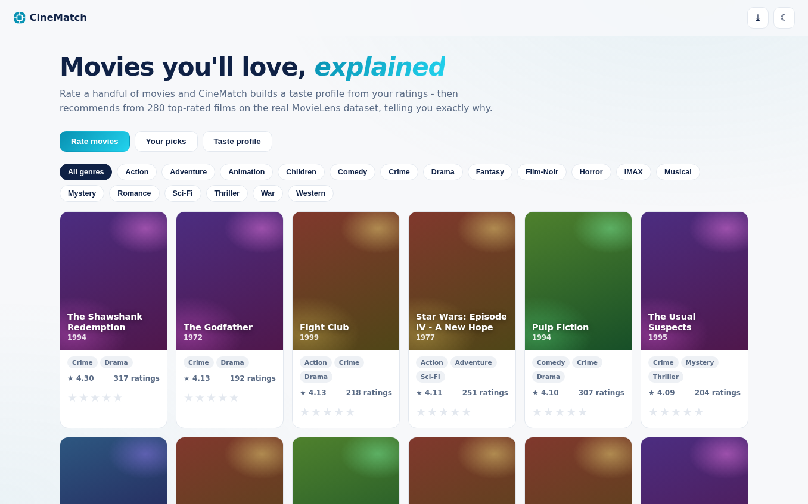
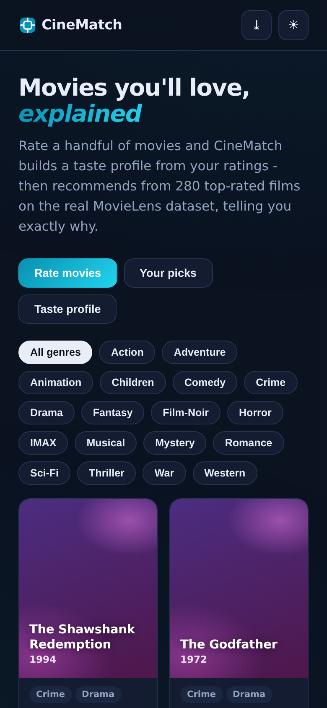

# CineMatch - Movie Recommender

Rate a few movies, get recommendations **explained by your own taste profile** - built on the real MovieLens latest-small research dataset, running fully offline.

**Live demo:** https://akash991833.github.io/movie-recommender/

## Features

- **Real data** - 280 top-rated films from MovieLens (100k ratings), ranked by Bayesian average with rating counts shown
- **Content-based taste profile** - your star ratings build a weighted genre vector; watch it update in the Taste Profile tab
- **Explained recommendations** - every pick shows "Because you liked X" plus the matching genres
- **Genre filters** and full catalog browsing with quality-prior scoring
- **Genre-tinted generated posters** - deterministic per-genre gradient art, zero image downloads
- **Private by design** - ratings live in localStorage on your device only
- **PWA** - installable, offline after first load
- **Premium UI** - white professional design, navy ink, cyan accent, dark + light themes, responsive desktop and mobile

## Screenshots

## Honest limits

Content-based matching over a 280-film catalog (no cross-user collaborative filtering), no licensed poster art, catalog ends at 2018. All stated in-app.

## Tech

Vanilla HTML/CSS/JS. Dataset: MovieLens latest-small (GroupLens Research).

## Run locally

Open `index.html` or serve the folder (`python3 -m http.server`).
